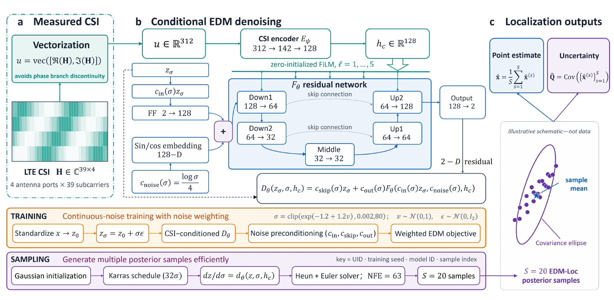
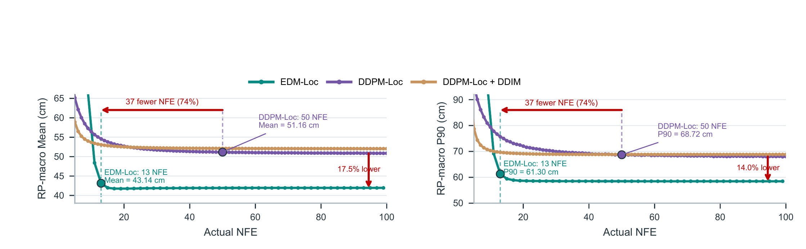
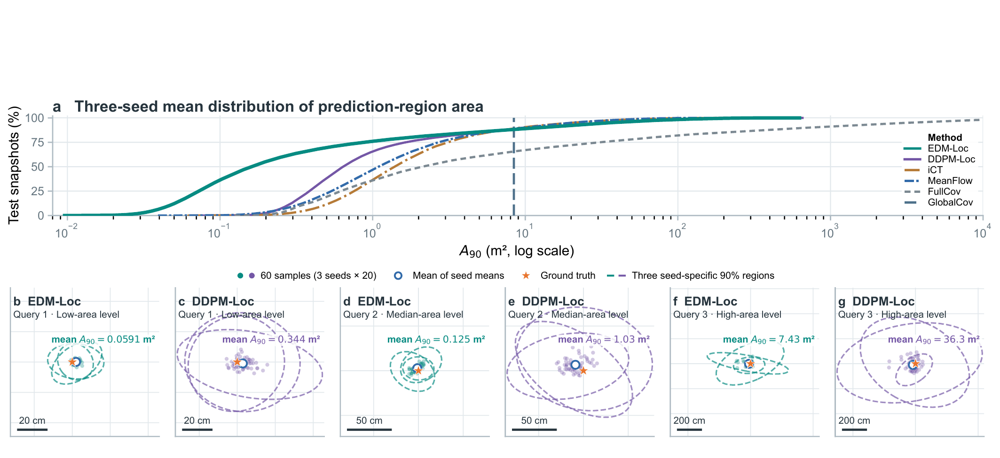

# EDM-Loc: More Accurate Probabilistic Localization with Fewer Denoiser Evaluations

Code for the manuscript *EDM-Loc: More Accurate Probabilistic Localization with Fewer Denoiser Evaluations* (ICASSP 2027 submission).

## Overview

EDM-Loc estimates a position distribution from measured LTE channel state information (CSI). It combines feature-wise CSI conditioning, noise-dependent preconditioning, and a second-order sampler to produce accurate location estimates with fewer denoiser evaluations. The model represents CSI through its real and imaginary components and draws multiple position samples to describe both the estimated location and its uncertainty.



### Key contributions

- **CSI-conditioned localization:** A feature-wise conditioning strategy connects measured CSI to the position denoiser.
- **Probabilistic predictions:** EDM preconditioning and multiple position samples support both location estimates and uncertainty assessment.
- **Efficient sampling:** A second-order sampler reduces the number of denoiser evaluations needed for accurate localization.

## Paper results

The manuscript evaluates EDM-Loc on measured LTE CSI, with training, development, calibration, and test reference points kept separate. Its main comparison includes eight other methods: DDPM-Loc, iCT, MeanFlow, FullCov, GlobalCov, MLP, CNN, and KNN. In Table 1, EDM-Loc has the lowest reported RP-macro mean error (41.93 cm) and RP-macro P90 error (58.49 cm) among the evaluated methods, as well as the lowest energy score (32.65 cm) among methods that report it.

### Accuracy and sampling budget



Figure 2 compares test-set localization error at different sampling budgets. With 13 denoiser evaluations, EDM-Loc reaches 43.14 cm RP-macro mean error and 61.30 cm RP-macro P90 error. Both are below DDPM-Loc at 50 evaluations (51.16 cm and 68.72 cm), using 37 fewer evaluations. The horizontal axis counts denoiser calls, not elapsed time.

### Calibrated prediction regions



Figure 3 compares the areas of nominal 90% prediction regions and shows three paired test examples. EDM-Loc has smaller regions over the lower and central parts of the area distribution. In each paired example, its regions are smaller than DDPM-Loc's for the same observation and plot scale. Region size should be read together with empirical coverage; smaller regions alone do not establish better calibration. At higher area percentiles, iCT and MeanFlow can have smaller regions.

These figures are exports from the manuscript experiments. The original measurements, trained paper checkpoints, calibration results, and figure source data are not included, so the images cannot be regenerated from this repository alone.

## Methods and repository layout

| Path | What it contains |
|---|---|
| `src/edm_loc/` | The proposed model, CSI conversion, training objective, and sampler |
| `src/paper_baselines/` | Implementations of the eight comparison methods in Table 1 |
| `scripts/` | Entrypoints for new EDM-Loc training, evaluation, metric averaging, and basic checks |
| `figures/` | The three manuscript figures shown above |

The comparison methods cover diffusion sampling (DDPM-Loc), one-step generation (iCT and MeanFlow), Gaussian prediction (FullCov and GlobalCov), and point prediction (MLP, CNN, and KNN). See the [method and evidence map](docs/METHODS_AND_EVIDENCE.md) for implementation details and the limits of the released material.

## Getting started

Use Python 3.11 or a compatible Python 3 version. Install a PyTorch build suitable for your CPU or CUDA environment, then install the remaining dependencies:

```bash
python -m pip install -r requirements.txt
python scripts/smoke_test.py
python scripts/verify_release.py
```

The smoke check runs without the OpenCSI data. Training and evaluation require you to prepare the data described below.

## Train and evaluate three new runs

Prepare separate training, development, and held-out evaluation `.npz` files. Each file needs four arrays:

| Array | Shape | Meaning |
|---|---|---|
| `raw_ap` | `[N, 2, 39, 4]` | CSI amplitude and phase, in that order |
| `coordinates_cm` | `[N, 2]` | Position in centimeters |
| `rp_ids` | `[N]` | Reference-point IDs |
| `global_uids` | `[N]` | Unique snapshot IDs |

The training and development sets must have distinct reference points and snapshot IDs. The training script learns CSI and coordinate normalization from the training set only, then applies it to development data. Keep the same held-out evaluation file for all three seeds. If you want to compare new results with the manuscript, use the paper's reference-point split (2,509 training / 398 development / 279 calibration / 399 test RPs) and the same input selection; a different split is a different experiment.

Run the three seeds separately. The following Bash example trains each model, evaluates its selected checkpoint on the same held-out file, and writes results to separate directories:

Both commands use CUDA by default. Add `--device cpu` to each command when running without a CUDA GPU.

```bash
for seed in 2031 2032 2033; do
  python scripts/train_edm_loc.py \
    --train-npz data/train.npz \
    --development-npz data/development.npz \
    --output-dir "outputs/edm_seed${seed}" \
    --seed "$seed"

  python scripts/evaluate_edm_loc.py \
    --checkpoint "outputs/edm_seed${seed}/best_checkpoint.pt" \
    --input-npz data/evaluation.npz \
    --output-dir "outputs/evaluation_seed${seed}"
done

python scripts/average_edm_metrics.py \
  outputs/evaluation_seed2031/metrics.json \
  outputs/evaluation_seed2032/metrics.json \
  outputs/evaluation_seed2033/metrics.json \
  --output outputs/three_seed_metrics.json
```

Each evaluation reports localization error and energy score for its own model. The final command takes the arithmetic mean of each reported metric across the three seeds and checks that all three results used the same input file. The default sampler draws 20 positions per input with 63 denoiser evaluations per trajectory. Training uses development results to select a checkpoint; evaluation does not fit a prediction-region calibrator. Reproducing the manuscript's calibrated regions requires the separate calibration data and artifacts.

These commands create new models and new evaluations. Their outputs are not the manuscript's frozen test results.
